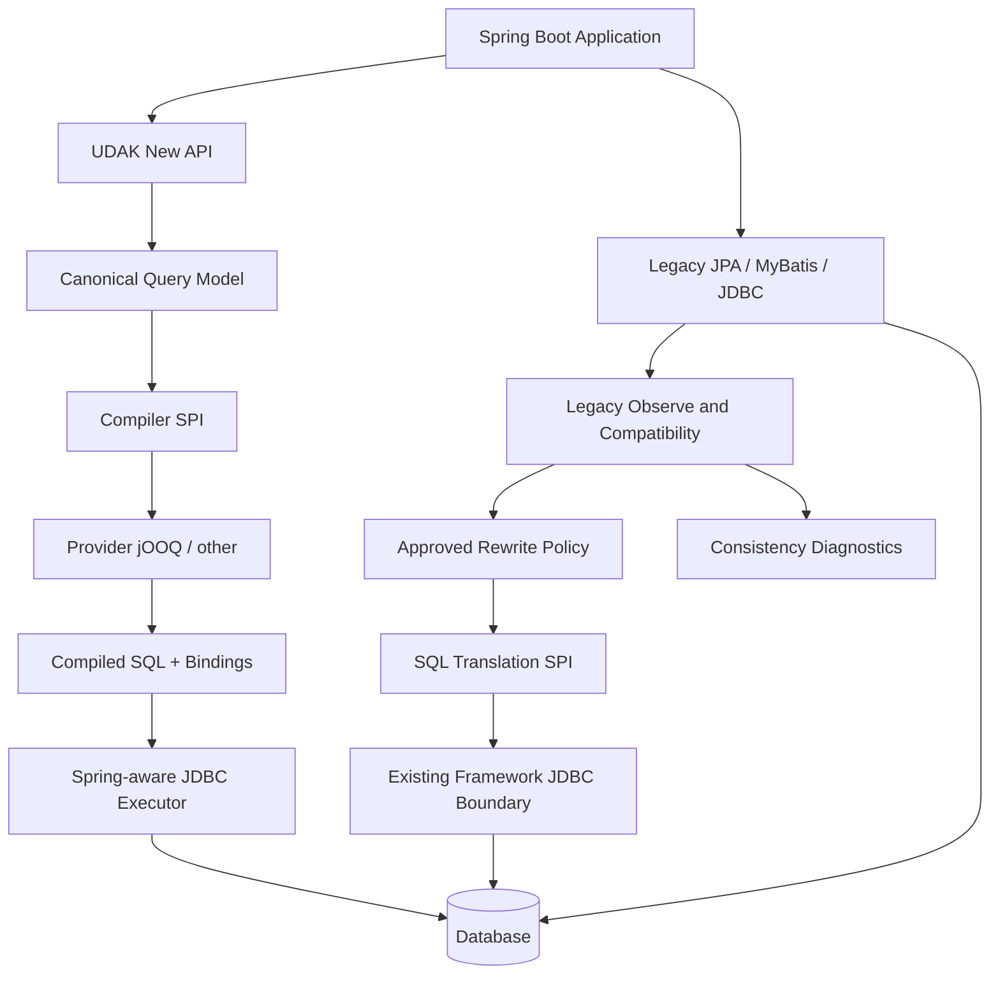
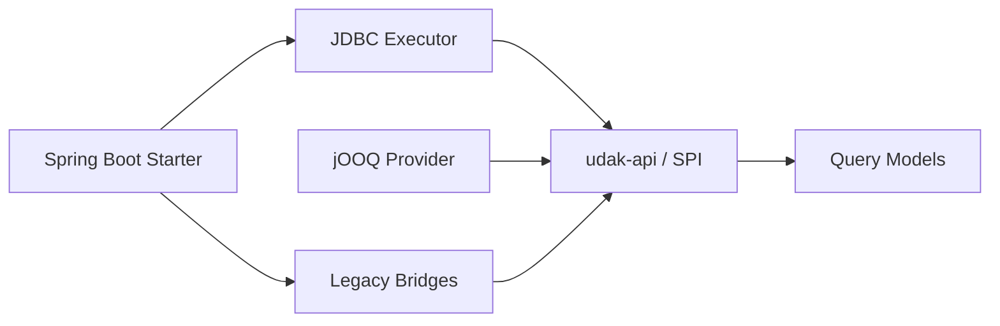

# Architecture — Clean + Hexagonal + SPI

English | [한국어](../ko/02-ARCHITECTURE.md)

## 1. Context View

`B → M` means that the existing execution path remains intact. Observe/Analyze does not force SQL calls to move to a new executor.

## 2. Module Boundaries

- `core`: JDK only, `SqlCompiler`, `DbVendor`, minimal AST model, ApprovalGuard, Config Guard. **Currently implemented**
- `spring-boot-demo`: Example mixing Spring Data JPA + MyBatis + JdbcTemplate. **Code provided**
- `udak-api`, `sql-jooq`, `legacy-jpa`, `legacy-mybatis`, `legacy-jdbc`, `boot3-starter`, `boot4-starter`, `testkit`: **Target modules, not yet implemented**

### Dependency Direction

SPI modules do not reference external Provider types. `core` does not reference Spring Boot/Hibernate/MyBatis.

## 3. Runtime Paths

**New:** `UdakClient` → immutable query model → compiler → SQL/ordered bindings → Spring-aware executor → JDBC driver.

**Legacy observation:** Repository/Mapper/Template → existing executor → Boundary/Interceptor observation → existing JDBC Driver.

**Legacy conversion:** query identity → check approval against hash+environment conditions → provider translate → validate parameter/column contract → existing executor (conditional).

## 4. Failure Handling

- Parser failure: report=`UNKNOWN`; prohibit automatic conversion in production
- Unsupported Dialect: typed `UnsupportedCapabilityException`
- Hash/version mismatch: `RewriteRejectedException` + audit record
- Connection/timeout: surface consistently with Spring `DataAccessException` types
- Multiple DBs: do not guarantee shared atomicity through local @Transactional; startup diagnostic

## 5. Logging and Measurement

Use a standard SQL query ID as the default tag. Do not expose full SQL text, user identifiers, or parameter values in high-cardinality metric labels.

## 6. Structural Verification

- ArchUnit: core ↛ org.springframework, jakarta.persistence, org.apache.ibatis
- API compatibility: japicmp or Revapi
- Gradle dependency locking / verification
- Actual DB integration gates using Testcontainers
- SQL snapshots + comparison of sorting/NULL/temporal type results
