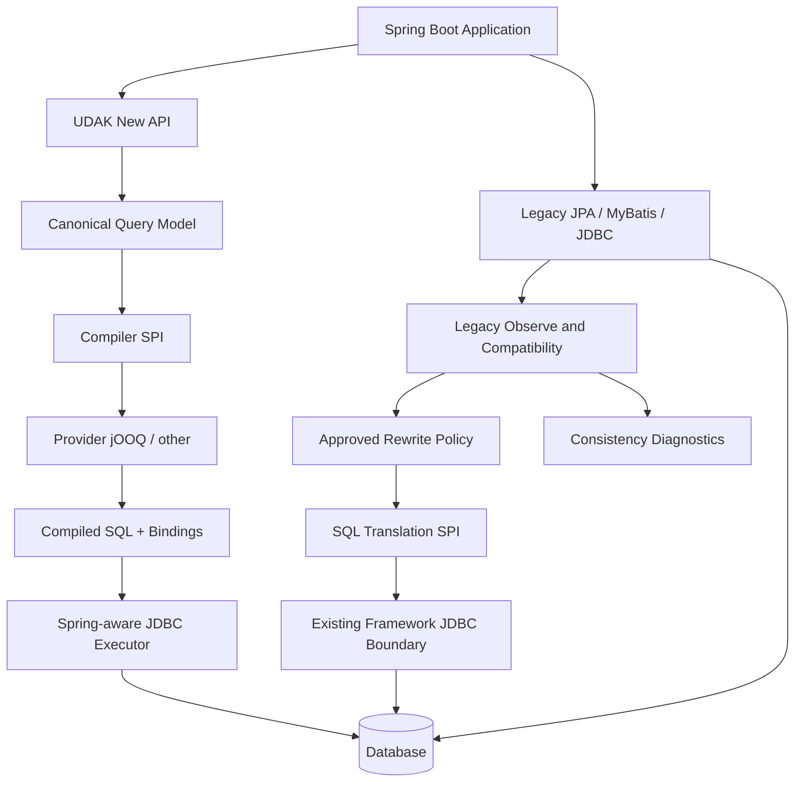
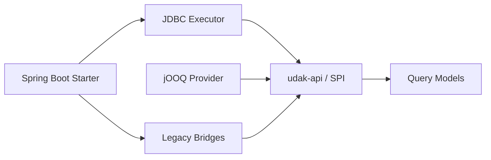

# Architecture — Clean + Hexagonal + SPI

English | [한국어](../ko/02-ARCHITECTURE.md)

## 1. Context View

`B → M` means that the existing execution path remains intact. Observe/Analyze does not force SQL calls to move to a new executor.

## 2. Module boundaries

- `core`: JDK-only compiler/SPI and original static guards.
- `spring-boot-demo`: existing business sources verified programmatically; full Boot/Gradle execution NOT RUN.
- `udak-api`, `jdbc-spring`, `db-testkit`, `sql-jsqlparser`: implemented minimal API/executor, DB verification and parser-validation contracts.
- `observe-core`, `legacy-observe`, `legacy-compat-testkit`: implemented Observe and same-DS compatibility contracts.
- `consistency-core`, `consistency-spring`, `consistency-testkit`: explicit policy/configuration/current-thread diagnostics and Spring/H2 contracts. See [Phase 4 boundaries](22-TRANSACTION-GUARD-RESULTS.md).
- `sql-jooq`, `boot3-starter`, `boot4-starter`: future modules, not implemented.

### Dependency Direction

SPI modules do not reference external Provider types. `core` does not reference Spring Boot/Hibernate/MyBatis.

## 3. Runtime Paths

**New:** `UdakClient` → immutable query model → compiler → SQL/ordered bindings → Spring-aware executor → JDBC driver.

**Legacy observation:** Repository/Mapper/Template → existing executor → Boundary/Interceptor observation → existing JDBC Driver.

**Legacy conversion:** query identity → check approval against hash+environment conditions → provider translate → validate parameter/column contract → existing executor (conditional).

## 4. Failure Handling

- Parser failure: report=`UNKNOWN`; prohibit automatic conversion in production
- Unsupported Dialect: typed `UnsupportedCapabilityException`
- Hash/version mismatch: `RewriteRejectedException` + audit record
- Connection/timeout: surface consistently with Spring `DataAccessException` types
- Multiple DBs: do not guarantee shared atomicity through local @Transactional; startup diagnostic

## 5. Logging and Measurement

Use a standard SQL query ID as the default tag. Do not expose full SQL text, user identifiers, or parameter values in high-cardinality metric labels.

## 6. Structural Verification

- ArchUnit: core ↛ org.springframework, jakarta.persistence, org.apache.ibatis
- API compatibility: japicmp or Revapi
- Gradle dependency locking / verification
- Actual DB integration gates using Testcontainers
- SQL snapshots + comparison of sorting/NULL/temporal type results

## Phase 5 approved selective rewrite path

The JDK-only approval/evidence registry and provider SPI in `rewrite-core` compose with the limited paging implementation in `rewrite-jsqlparser`. The explicit `rewrite-jdbc` client checks the approval, translation plan and actual target JDBC metadata before running a read query on the existing DataSource. `rewrite-testkit` compares independent expected results. The existing Observe paths and Core dependency boundaries remain in effect. Local contracts and fixed-fixture equivalence on four real databases passed G4. [Phase 5 results](23-SELECTIVE-REWRITE-RESULTS.md)
