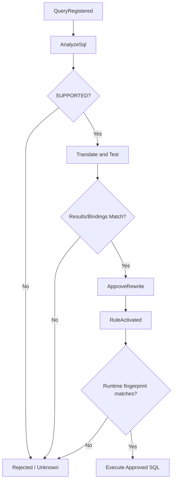

# UseCases + EventStorming + Flow

English | [한국어](../ko/10-USECASES-EVENTSTORMING.md)

## UseCase Specifications

| UC | Actor | Preconditions | Main Flow | Failure/Exception | Validation |
|---|---|---|---|---|---|
| UC-001 | New development developer | DB connection/schema registration | DSL → compile → execute → map | Unsupported SQL/invalid ID | CT-SQL-001 |
| UC-002 | Maintenance developer | Existing mapper/repository | observe → query id → report | Reject sensitive parameter exposure | CT-LEG-001 |
| UC-003 | DBA | Source/target DB declared | analyze → capability → report | UNKNOWN state | CT-DIALECT-001 |
| UC-004 | Approver | Verification evidence available | rule approve → activate | Reject hash/version mismatch | CT-APPROVE-001 |
| UC-005 | Operator | tx manager config | startup scan → risk report | multi-datasource block | CT-TX-001 |
| UC-006 | QA | schema / input dataset | source+target result compare | result mismatch reject | CT-COMP-001 |

## EventStorming (Hypothetical Product Domain Events)

- 🟨 Actor: Developer / Reviewer / DBA / Release Manager
- 🟦 Command: RegisterQuery / AnalyzeSql / VerifyTranslation / ApproveRewrite / ActivateRule / CheckTransactionConfig
- 🟧 Domain Event: QueryRegistered / CompatibilityAnalyzed / TranslationVerified / RewriteApproved / RuleActivated / TransactionRiskDetected
- 🟩 Aggregate: QueryCatalog / RewriteApproval / CompatibilityEvidence / RuntimePolicy
- 🟪 Policy: `RuleActivated` requires `RewriteApproved` and environment/version/hash match
- 🟥 External: JDBC Driver / SQL Provider / CI Runner / Database

## Approval Flow



## Transaction Flow

```mermaid
flowchart TD
    A[@Transactional] --> B[Spring TxManager]
    B --> C{Single resource?}
    C -- Yes --> D[Spring-managed Connection]
    D --> E[JPA / MyBatis / JDBC]
    C -- No --> F[Warn / Block / XA-Saga explicit]
    E --> G[flush/cache contract tests]
```
