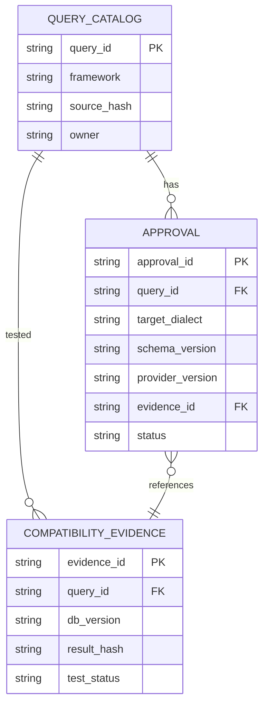

# Configuration and Runtime Contracts

English | [한국어](../ko/11-API-CONFIG-SCHEMA.md)

## Starter Configuration

```yaml
udak:
  enabled: true
  mode: OBSERVE
  legacy:
    default-mode: OBSERVE
    rewrite:
      enabled: false
  rewrite:
    enabled: false
  observability:
    log-parameters: false
  jdbc:
    enabled: false
    query-timeout-seconds: 5
    max-rows: 1000
```

The YAML lists the defaults for both Phase 6 Starters. Set `udak.enabled=false` to suppress the default Observe and JDBC beans. The startup guard continues to validate the settings. `udak.mode` and `udak.legacy.default-mode` accept only `OBSERVE` (case-insensitive). Setting either rewrite flag or `udak.observability.log-parameters` to `true` fails startup with a message naming the setting.

For JDBC opt-in, set `udak.jdbc.enabled=true` and `udak.jdbc.vendor` to one of `POSTGRESQL`, `MYSQL`, `SQLSERVER`, `ORACLE_19` or `ORACLE_11`. With one DataSource and no application-provided `SqlExecutor`, the Starter registers the lazy executor. Query timeout accepts 1–30 seconds and max rows accepts 1–1,000. [Starter scope](24-STARTERS-CLI-RELEASE-GATES.md)

## Policy Tables/ERD (If a Registry Store Is Built)



## Selective Translation Runtime Policy

Input Query ID, SQL exact hash, source/target vendor, schema/provider/runtime version → look up the approval Registry → block on mismatch → run parser/translator → validate binding metadata → execute SQL.

By default, nativeSQL executes unchanged (without translation). Rewrite is prohibited without explicit approval.

## Phase 4 explicit configuration API

Phase 4 exposes a Java `SpringConsistencyGuard.Configuration` for explicitly supplied handles. The application invokes the guard separately and inspection leaves managers and framework configuration intact. [Manual wiring and enforcement](22-TRANSACTION-GUARD-RESULTS.md)

## Phase 5 explicit registration

Phase 5 uses explicit Java configuration with an operator supplying approvals and evidence to the in-memory `Rewrite.Registry`. The eight `Environment` fields and fingerprints for target SQL and the plan let the runtime recheck approval after environment, schema, provider or runtime changes. In-memory revocation blocks admission before the final authorization check. The Registry storage schema above is a design proposal. Automatic rewrite wiring and persistent production approval issuance are NOT RUN. G4 passed for the fixed fixture. Production approval remains pending. [Phase 5 results](23-SELECTIVE-REWRITE-RESULTS.md)
