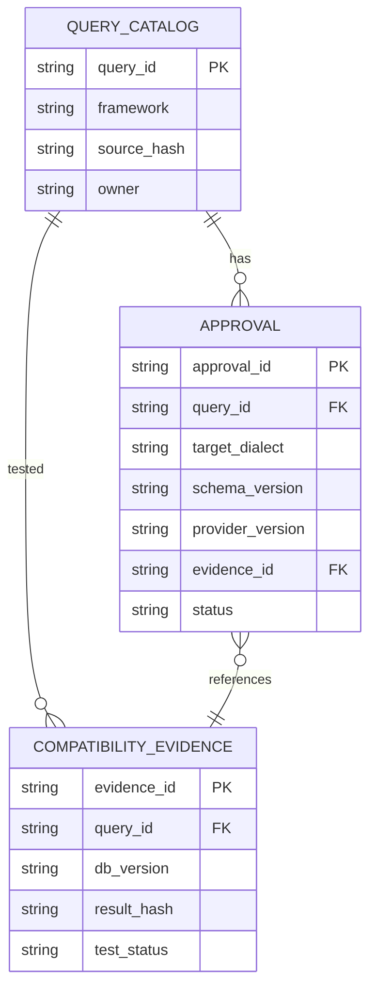

# Configuration / Contract Sketch (Unimplemented Design Proposal)

English | [한국어](../ko/11-API-CONFIG-SCHEMA.md)

## Candidate Starter Configuration

```yaml
udak:
  enabled: true
  sql:
    compiler-provider: jooq
    dialect-detection: strict
    max-page-size: 1000
  legacy:
    default-mode: observe
    jpa:
      enabled: true
    mybatis:
      enabled: true
    jdbc:
      enabled: true
    rewrite:
      enabled: false
      failure-policy: reject
      approval-location: classpath:udak-approvals.yml
  consistency:
    multi-datasource-local-transaction: warn
    mixed-jpa-sql: warn
    timezone-policy: utc-instant
  observability:
    enabled: true
    log-parameters: false
```

**This is an example configuration for a future UDAK Starter and does not work as configuration for the current demo.**

## Policy Tables/ERD (If a Registry Store Is Built)



## Selective Translation Runtime Policy

Input Query ID, SQL exact hash, source/target vendor, schema/provider/runtime version → look up the approval Registry → block on mismatch → run parser/translator → validate binding metadata → execute SQL.

By default, nativeSQL executes unchanged (without translation). Rewrite is prohibited without explicit approval.

## Phase 4 explicit configuration API

The proposed YAML above remains unimplemented. Phase 4 exposes a Java `SpringConsistencyGuard.Configuration` for explicitly supplied handles, with no bean discovery or property binding. Use [manual wiring and enforcement](22-TRANSACTION-GUARD-RESULTS.md); managers and framework configuration are not changed by inspection.

## Phase 5 explicit registration

Phase 5 uses explicit Java configuration with an operator supplying approvals and evidence to the in-memory `Rewrite.Registry`. The eight `Environment` fields and fingerprints for target SQL and the plan let the runtime recheck approval after environment, schema, provider or runtime changes. In-memory revocation blocks admission before the final authorization check. The Starter YAML and storage schema above are design proposals. Autoconfiguration and persistent production approval issuance are NOT RUN. [Phase 5 results](23-SELECTIVE-REWRITE-RESULTS.md)
