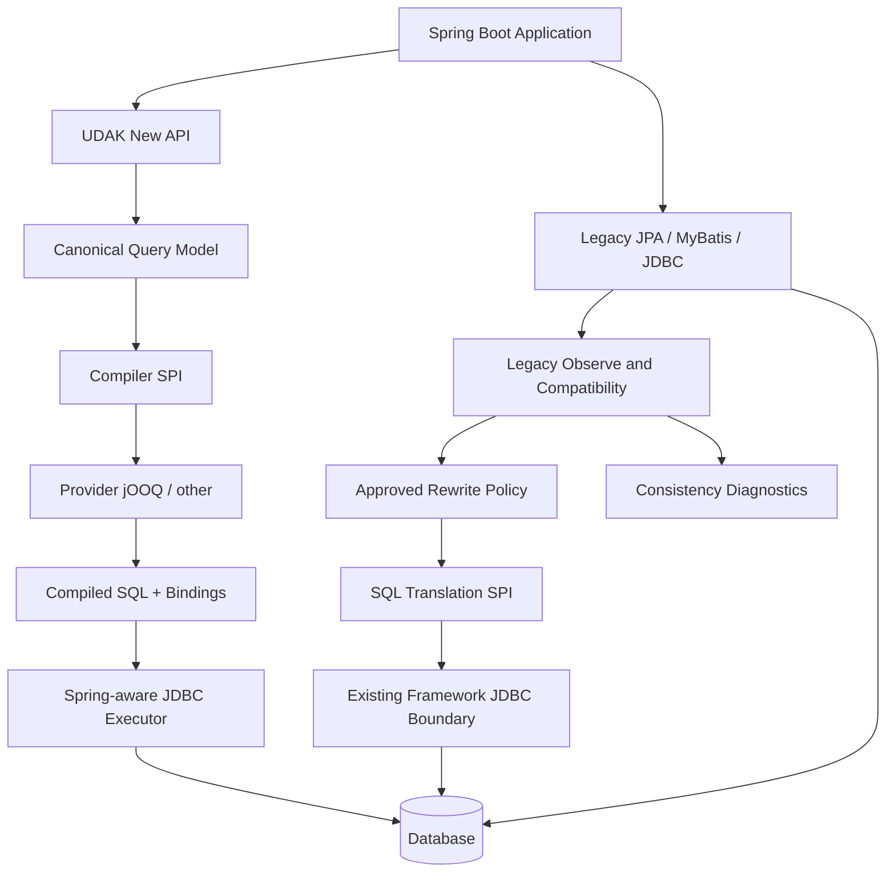
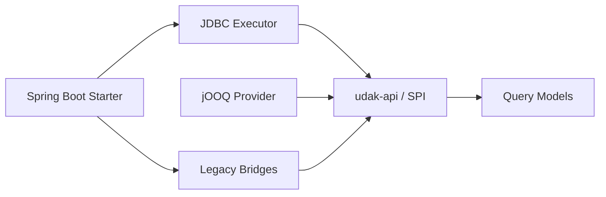

# Architecture — Clean + Hexagonal + SPI

[English](../en/02-ARCHITECTURE.md) | 한국어

## 1. 컨텍스트 뷰

`B → M`는 기존 실행 경로 그대로라는 뜻. Observe/Analyze는 SQL 호출을 강제로 새 executor로 옮기지 않는다.

## 2. 모듈 경계

- `core`: JDK만, `SqlCompiler`, `DbVendor`, AST 최소 모델, ApprovalGuard, Config Guard. **현재 구현**
- `spring-boot-demo`: Spring Data JPA + MyBatis + JdbcTemplate 혼합 사용 예제. **코드 제공**
- `udak-api`, `sql-jooq`, `legacy-jpa`, `legacy-mybatis`, `legacy-jdbc`, `boot3-starter`, `boot4-starter`, `testkit`: **목표 모듈, 아직 미구현**

### 의존성 방향

SPI 모듈은 외부 Provider 타입을 참조하지 않는다. `core`는 Spring Boot/Hibernate/MyBatis를 참조하지 않는다.

## 3. 런타임 경로

**신규:** `UdakClient` → immutable query model → compiler → SQL/ordered bindings → Spring-aware executor → JDBC driver.

**레거시 관측:** Repository/Mapper/Template → 기존 실행기 → Boundary/Interceptor 관측 → 기존 JDBC Driver.

**레거시 변환:** query identity → hash+환경 조건 승인 확인 → provider translate → 파라미터/컬럼 계약 검증 → 기존 실행기 (조건부).

## 4. 실패 처리

- Parser 실패: report=`UNKNOWN`; 실운영 자동 변환 금지
- Dialect 미지원: typed `UnsupportedCapabilityException`
- 해시/버전 불일치: `RewriteRejectedException` + 감사 기록
- Connection/timeout: Spring `DataAccessException` 계열과 일관되게 표면화
- 다중 DB: 로컬 @Transactional 공유 원자성 보장 금지, startup diagnostic

## 5. 로깅·측정

표준 SQL query ID를 기본 태그로 사용한다. SQL 전체 텍스트, 사용자 식별자, 파라미터 값을 high cardinality metric label에 노출하지 않는다.

## 6. 구조 검증

- ArchUnit: core ↛ org.springframework, jakarta.persistence, org.apache.ibatis
- API compatibility: japicmp 또는 Revapi
- Gradle dependency locking / verification
- Testcontainers로 실제 DB integration 게이트
- SQL snapshot + 정렬/NULL/시간타입 결과 비교
