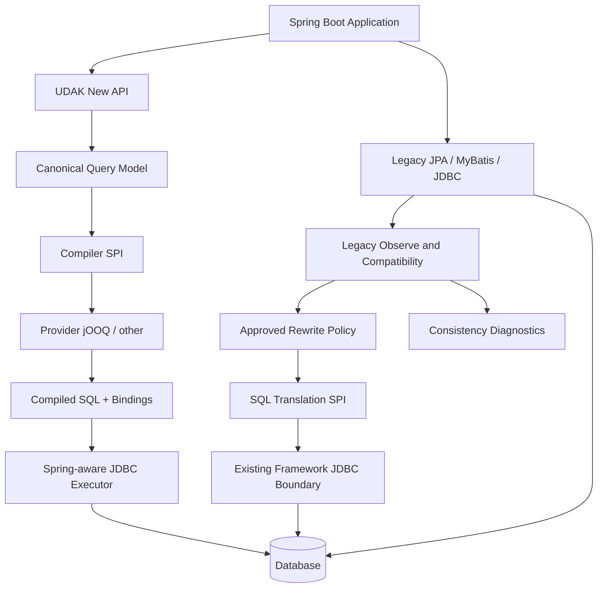
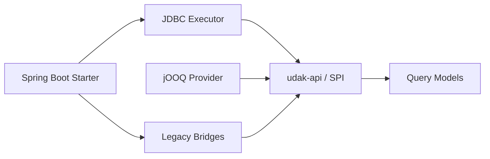

# Architecture — Clean + Hexagonal + SPI

[English](../en/02-ARCHITECTURE.md) | 한국어

## 1. 컨텍스트 뷰

`B → M`는 기존 실행 경로 그대로라는 뜻. Observe/Analyze는 SQL 호출을 강제로 새 executor로 옮기지 않는다.

## 2. 모듈 경계

- `core`: JDK 전용 컴파일러/SPI와 기존 정적 guard.
- `spring-boot-demo`: 기존 업무 소스를 프로그램 방식으로 검증; 전체 Boot/Gradle 실행 NOT RUN.
- `udak-api`, `jdbc-spring`, `db-testkit`, `sql-jsqlparser`: 최소 API·실행기, DB 검증과 파서 검증 계약 구현.
- `observe-core`, `legacy-observe`, `legacy-compat-testkit`: Observe와 동일 DS 호환성 계약 구현.
- `consistency-core`, `consistency-spring`, `consistency-testkit`: 명시적 정책·구성·현재 스레드 진단 및 Spring/H2 계약. [Phase 4 경계](22-TRANSACTION-GUARD-RESULTS.md)를 따른다.
- `sql-jooq`, `boot3-starter`, `boot4-starter`: 목표 모듈, 미구현.

### 의존성 방향

SPI 모듈은 외부 Provider 타입을 참조하지 않는다. `core`는 Spring Boot/Hibernate/MyBatis를 참조하지 않는다.

## 3. 런타임 경로

**신규:** `UdakClient` → immutable query model → compiler → SQL/ordered bindings → Spring-aware executor → JDBC driver.

**레거시 관측:** Repository/Mapper/Template → 기존 실행기 → Boundary/Interceptor 관측 → 기존 JDBC Driver.

**레거시 변환:** query identity → hash+환경 조건 승인 확인 → provider translate → 파라미터/컬럼 계약 검증 → 기존 실행기 (조건부).

## 4. 실패 처리

- Parser 실패: report=`UNKNOWN`; 실운영 자동 변환 금지
- Dialect 미지원: typed `UnsupportedCapabilityException`
- 해시/버전 불일치: `RewriteRejectedException` + 감사 기록
- Connection/timeout: Spring `DataAccessException` 계열과 일관되게 표면화
- 다중 DB: 로컬 @Transactional 공유 원자성 보장 금지, startup diagnostic

## 5. 로깅·측정

표준 SQL query ID를 기본 태그로 사용한다. SQL 전체 텍스트, 사용자 식별자, 파라미터 값을 high cardinality metric label에 노출하지 않는다.

## 6. 구조 검증

- ArchUnit: core ↛ org.springframework, jakarta.persistence, org.apache.ibatis
- API compatibility: japicmp 또는 Revapi
- Gradle dependency locking / verification
- Testcontainers로 실제 DB integration 게이트
- SQL snapshot + 정렬/NULL/시간타입 결과 비교

## Phase 5 승인 선택 변환 경로

`rewrite-core`의 JDK 전용 승인·증거 Registry와 Provider SPI를 `rewrite-jsqlparser`의 제한 paging 구현과 조합한다. 명시적 `rewrite-jdbc` 클라이언트는 승인·변환 계획 및 실제 대상 JDBC 메타데이터를 확인한 뒤 기존 DataSource의 읽기 쿼리를 실행한다. `rewrite-testkit`은 독립 기대 결과와 비교한다. 기존 Observe 경로와 Core 의존성 경계는 유지한다. 로컬 계약과 고정 fixture의 4종 실DB 동등성으로 G4를 통과했다. [Phase 5 결과](23-SELECTIVE-REWRITE-RESULTS.md)
