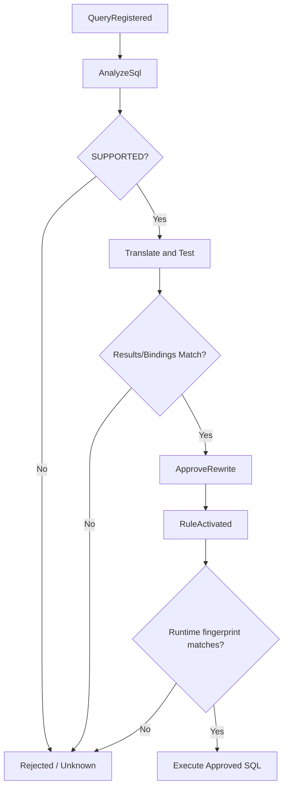

# UseCases + EventStorming + Flow

[English](../en/10-USECASES-EVENTSTORMING.md) | 한국어

## UseCase 명세

| UC | 액터 | 전제 | 주요 흐름 | 실패/예외 | 검증 |
|---|---|---|---|---|---|
| UC-001 | 신규 개발자 | DB 연결/스키마 등록 | DSL → compile → execute → map | 미지원 SQL/잘못된 ID | CT-SQL-001 |
| UC-002 | 유지보수 개발자 | 기존 mapper/repository | observe → query id → report | 민감 파라미터 노출 거부 | CT-LEG-001 |
| UC-003 | DBA | 소스/대상 DB 선언 | analyze → capability → report | UNKNOWN 상태 | CT-DIALECT-001 |
| UC-004 | 승인자 | 검증 증거 확보 | rule approve → activate | hash/version mismatch 거부 | CT-APPROVE-001 |
| UC-005 | 운영자 | tx manager config | startup scan → risk report | multi-datasource block | CT-TX-001 |
| UC-006 | QA | schema / input dataset | source+target result compare | result mismatch reject | CT-COMP-001 |

## EventStorming (가설적 제품 도메인 이벤트)

- 🟨 Actor: Developer / Reviewer / DBA / Release Manager
- 🟦 Command: RegisterQuery / AnalyzeSql / VerifyTranslation / ApproveRewrite / ActivateRule / CheckTransactionConfig
- 🟧 Domain Event: QueryRegistered / CompatibilityAnalyzed / TranslationVerified / RewriteApproved / RuleActivated / TransactionRiskDetected
- 🟩 Aggregate: QueryCatalog / RewriteApproval / CompatibilityEvidence / RuntimePolicy
- 🟪 Policy: `RuleActivated` requires `RewriteApproved` and environment/version/hash match
- 🟥 External: JDBC Driver / SQL Provider / CI Runner / Database

## 승인 흐름



## 트랜잭션 흐름

```mermaid
flowchart TD
    A[@Transactional] --> B[Spring TxManager]
    B --> C{Single resource?}
    C -- Yes --> D[Spring-managed Connection]
    D --> E[JPA / MyBatis / JDBC]
    C -- No --> F[Warn / Block / XA-Saga explicit]
    E --> G[flush/cache contract tests]
```
