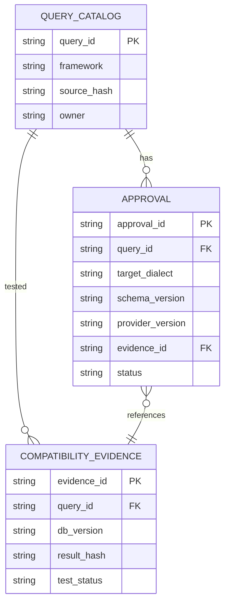

# Configuration / Contract Sketch (미구현 설계안)

[English](../en/11-API-CONFIG-SCHEMA.md) | 한국어

## Starter 설정 후보

```yaml
udak:
  enabled: true
  sql:
    compiler-provider: jooq
    dialect-detection: strict
    max-page-size: 1000
  legacy:
    default-mode: observe
    jpa:
      enabled: true
    mybatis:
      enabled: true
    jdbc:
      enabled: true
    rewrite:
      enabled: false
      failure-policy: reject
      approval-location: classpath:udak-approvals.yml
  consistency:
    multi-datasource-local-transaction: warn
    mixed-jpa-sql: warn
    timezone-policy: utc-instant
  observability:
    enabled: true
    log-parameters: false
```

**이는 앞으로 개발할 UDAK Starter의 설정 예시이며 현재 demo의 설정으로 동작하지 않는다.**

## 정책 테이블/ERD (Registry 저장소를 만든다면)



## 선택 변환 런타임 정책

입력 Query ID, SQL exact hash, source/target vendor, schema/provider/runtime version → 승인 Registry 조회 → 불일치시 차단 → parser/translator 실행 → binding metadata 검증 → SQL 실행.

기본 nativeSQL은 그대로 실행 (변환하지 않음). 명시적 승인 없이는 rewrite 금지.

## Phase 4 명시적 구성 API

위 YAML 제안은 여전히 미구현이다. Phase 4는 명시적으로 전달한 자원의 Java `SpringConsistencyGuard.Configuration`을 제공하며 빈 발견·설정 바인딩은 수행하지 않는다. [수동 연결과 차단](22-TRANSACTION-GUARD-RESULTS.md)을 사용하고 검사는 매니저와 프레임워크 설정을 변경하지 않는다.

## Phase 5 명시적 등록

Phase 5는 운영자가 메모리의 `Rewrite.Registry`에 승인·검증 증거를 전달하는 명시적 Java 구성이다. `Environment` 8개 필드와 대상 SQL·계획 지문은 환경이나 스키마·provider·runtime 변경 시 승인 계약을 다시 확인할 수 있게 한다. 휘발성 Registry 폐기는 최종 승인 검사 전 진입을 차단한다. 상단의 Starter YAML과 저장소 스키마는 설계안이며 자동 구성·영속 승인 발급은 NOT RUN이다. 고정 fixture G4는 PASS이며 운영 승인은 미부여다. [Phase 5 결과](23-SELECTIVE-REWRITE-RESULTS.md)
