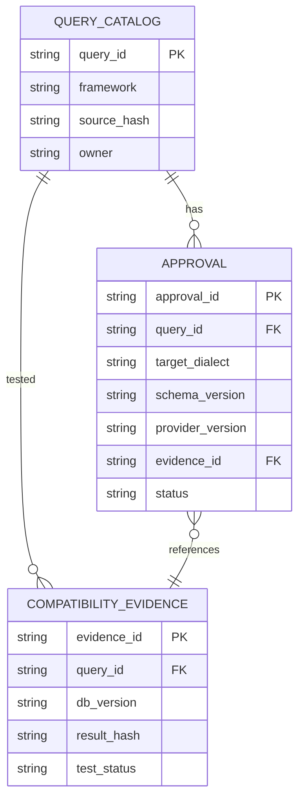

# Configuration / Contract Sketch (미구현 설계안)

[English](../en/11-API-CONFIG-SCHEMA.md) | 한국어

## Starter 설정 후보

```yaml
udak:
  enabled: true
  sql:
    compiler-provider: jooq
    dialect-detection: strict
    max-page-size: 1000
  legacy:
    default-mode: observe
    jpa:
      enabled: true
    mybatis:
      enabled: true
    jdbc:
      enabled: true
    rewrite:
      enabled: false
      failure-policy: reject
      approval-location: classpath:udak-approvals.yml
  consistency:
    multi-datasource-local-transaction: warn
    mixed-jpa-sql: warn
    timezone-policy: utc-instant
  observability:
    enabled: true
    log-parameters: false
```

**이는 앞으로 개발할 UDAK Starter의 설정 예시이며 현재 demo의 설정으로 동작하지 않는다.**

## 정책 테이블/ERD (Registry 저장소를 만든다면)



## 선택 변환 런타임 정책

입력 Query ID, SQL exact hash, source/target vendor, schema/provider/runtime version → 승인 Registry 조회 → 불일치시 차단 → parser/translator 실행 → binding metadata 검증 → SQL 실행.

기본 nativeSQL은 그대로 실행 (변환하지 않음). 명시적 승인 없이는 rewrite 금지.
