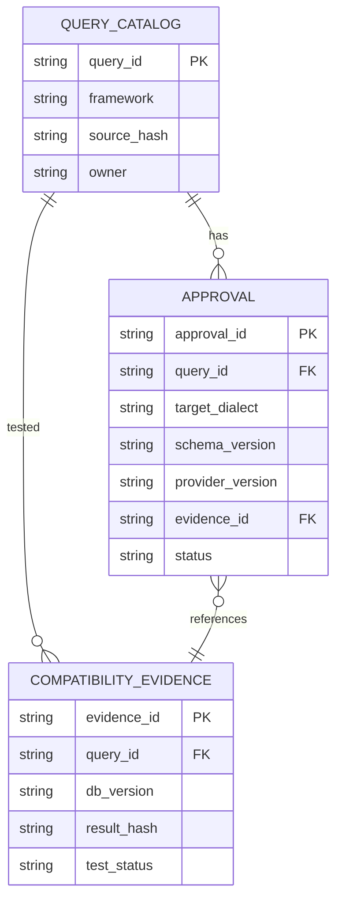

# 설정과 런타임 계약

[English](../en/11-API-CONFIG-SCHEMA.md) | 한국어

## Starter 설정

```yaml
udak:
  enabled: true
  mode: OBSERVE
  legacy:
    default-mode: OBSERVE
    rewrite:
      enabled: false
  rewrite:
    enabled: false
  observability:
    log-parameters: false
  jdbc:
    enabled: false
    query-timeout-seconds: 5
    max-rows: 1000
```

위 YAML은 Phase 6 두 Starter의 기본값이다. `udak.enabled=false`로 기본 Observe·JDBC 빈을 비활성화해도 시작 설정 검사는 수행한다. `udak.mode`와 `udak.legacy.default-mode`에는 대소문자 구분 없이 `OBSERVE`만 허용한다. 두 rewrite 플래그 중 하나나 `udak.observability.log-parameters`를 `true`로 설정하면 설정 키만 명시하는 시작 오류가 발생한다.

JDBC를 사용하려면 `udak.jdbc.enabled=true`로 설정하고 `udak.jdbc.vendor`에 `POSTGRESQL`, `MYSQL`, `SQLSERVER`, `ORACLE_19`, `ORACLE_11` 중 하나를 지정한다. DataSource가 한 개이고 사용자가 제공한 `SqlExecutor`가 없을 때 지연 초기화되는 실행기를 등록한다. 쿼리 제한 시간은 1–30초, 최대 행 수는 1–1,000 범위를 허용한다. [Starter 범위](24-STARTERS-CLI-RELEASE-GATES.md)

## 정책 테이블/ERD (Registry 저장소를 만든다면)



## 선택 변환 런타임 정책

입력 Query ID, SQL exact hash, source/target vendor, schema/provider/runtime version → 승인 Registry 조회 → 불일치시 차단 → parser/translator 실행 → binding metadata 검증 → SQL 실행.

기본 nativeSQL은 그대로 실행 (변환하지 않음). 명시적 승인 없이는 rewrite 금지.

## Phase 4 명시적 구성 API

Phase 4는 명시적으로 전달한 자원의 Java `SpringConsistencyGuard.Configuration`을 제공한다. 애플리케이션이 별도로 guard를 호출하며, 진단은 매니저와 프레임워크 설정을 유지한다. [수동 연결과 차단](22-TRANSACTION-GUARD-RESULTS.md)

## Phase 5 명시적 등록

Phase 5는 운영자가 메모리의 `Rewrite.Registry`에 승인·검증 증거를 전달하는 명시적 Java 구성이다. `Environment` 8개 필드와 대상 SQL·계획 지문은 환경이나 스키마·provider·runtime 변경 시 승인 계약을 다시 확인할 수 있게 한다. 휘발성 Registry 폐기는 최종 승인 검사 전 진입을 차단한다. 위 Registry 저장소 스키마는 설계안이다. 자동 rewrite 연결과 영속 운영 승인 발급은 NOT RUN이다. 고정 fixture G4는 PASS이며 운영 승인은 보류 상태다. [Phase 5 결과](23-SELECTIVE-REWRITE-RESULTS.md)
